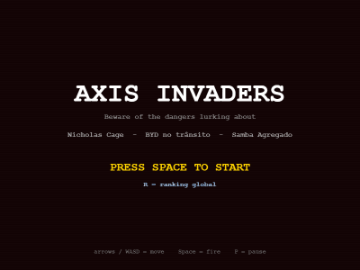

# Axis Invaders

  

  <b>▶ Jogue agora: <a href="https://tiagosalviatto.github.io/axis-invaders/">tiagosalviatto.github.io/axis-invaders</a></b> 
  no computador ou no celular

Um *Space Invaders* de navegador, em pixel art, que
**prepara os jogadores para o dia-a-dia no edifício Eixo**. Cada fase encena uma situação real da rotina do prédio —
e cada chefão é uma lição disfarçada de mini-boss. Defenda o seu posto.

Feito em HTML5 Canvas + JavaScript puro — sem framework, sem build, sem dependências.

## Conceito

A proposta é treinar, brincando, os hábitos do cotidiano no Eixo. As três fases sobem de
dificuldade no estilo clássico (mais fileiras, marcha e tiros mais rápidos a cada nível) e
abrem com uma breve cutscene narrando o contexto:

1. **Cage Rage** — *"Você deixou seu PC desbloqueado!"* O Nicholas Cage quer possuir sua
   máquina. **Lição: trave o computador ao se levantar.**
2. **BYD Velocity** — *"Você veio de carro para o escritório!"* Encare o trânsito.
   **Lição: considere vir de bike ou transporte público.**
3. **Samba Agregado Informal** — *"Happy hour com o time!"* O samba rola até o rapa aparecer.
   **Lição: confraternize (com responsabilidade).**

## Naves

Depois de escolher a nave você informa seu nome (fica lembrado no aparelho). Cada nave muda a
jogabilidade:

| Nave     | Perfil          | Movimento | Cadência de tiro |
|----------|-----------------|-----------|------------------|
| **BS**   | Equilibrada (?) | médio     | média            |
| **PC**   | Agilizada       | rápido    | mais lenta       |
| **ARTY** | Potente         | lento     | muito rápida     |

## Chefões

Cada fase termina num chefe em pixel art com barra de vida e padrão de ataque próprios. O
chefe final tem **duas fases**: ao derrotar a **viatura**, ela chama reforços e se divide em
**dois policiais** — um dá tiros guiados, o outro solta leques — cada um com sua barra de vida.

## Rankings

São dois tipos de ranking global (Supabase), todos com **nome, pontuação, tempo, nave e
dispositivo** (WEB ou MOB):

- **Por fase** — ao concluir cada fase, seu resultado *daquela fase* (pontos e tempo só dela) é
  gravado, e você vê na hora o ranking só daquela fase, com a sua linha destacada.
- **Geral** — quem **zera o jogo** entra no ranking geral com a pontuação total.

A pontuação premia completar as fases e a **velocidade** de cada uma. A tela de **RANKING**
(menu ou game over) tem abas — GERAL, FASE 1, FASE 2, FASE 3 — e fases novas ganham aba sozinhas.
Sem conexão, o jogo cai num placar local automaticamente.

## No celular

O jogo detecta o celular e se adapta:

- **Tela cheia em pé** — o campo de jogo acompanha o formato da tela, até a borda de baixo.
- **Arraste o dedo em qualquer lugar** para mover a nave (ela segue no limite de velocidade
  dela, então cada nave mantém sua personalidade). **O tiro é automático** enquanto o dedo
  está na tela. A nave fica um pouco acima do rodapé para o polegar não cobri-la.
- **Botão II** no canto para pausar; o jogo também pausa sozinho se você sair do app.
- Texto e botões maiores, imagem nítida na resolução real da tela.
- **Instale na tela inicial** (Safari: Compartilhar → *Adicionar à Tela de Início*; Chrome:
  menu → *Instalar app*) para abrir em tela cheia, como um app.
- Vibra ao levar dano (Android; navegadores do iPhone não permitem).

## Controles

**Teclado (computador)**

| Tecla                 | Ação                                         |
|-----------------------|----------------------------------------------|
| `Space`               | Iniciar · atirar · confirmar · sair do Game Over |
| `←` `→` / `A` `D`     | Mover · escolher nave · trocar aba do ranking |
| `↑` `↓` / `W` `S`     | Mover (faixa inferior da tela)               |
| `Enter`               | Confirmar nave / nome                        |
| `R`                   | Ver ranking (menu / game over)               |
| `Esc`                 | Voltar                                       |
| `P`                   | Pausar                                       |
| qualquer tecla        | Avançar as cutscenes                         |

Os botões da tela também funcionam com o mouse.

**Toque (celular)**: toque nos botões; arraste em qualquer lugar para mover (tiro automático);
toque para avançar as cutscenes; **II** para pausar.

## Como rodar

- **Online:** o link do GitHub Pages acima (HTTPS — ranking global e instalação funcionam).
- **Local:** sirva por HTTP — por exemplo `python -m http.server` — e acesse
  `http://localhost:8000`. Abrir o `index.html` direto (`file://`) funciona, mas só com o
  placar local (o Supabase bloqueia por CORS).
- **Testar o layout de celular no computador:** acrescente `?portrait` à URL.

As credenciais públicas do Supabase ficam em `src/config.js` (a *anon key* é segura de
versionar; o acesso é protegido por Row Level Security). Tabelas: `scores` (ranking geral) e
`stage_scores` (ranking por fase, filtrado pela coluna `stage`).

**Publicando uma versão nova:** a cada mudança em CSS/JS, atualize o `?v=` de **todos** os
arquivos no `index.html`. O GitHub Pages deixa o navegador guardar cada arquivo por 10 minutos;
sem isso, celulares podem misturar arquivos velhos e novos.

## Tech

- HTML5 Canvas + JavaScript puro (sem frameworks, build ou dependências).
- Sprites de inimigos/projéteis gerados por código a partir de uma mini-DSL de grade em texto;
  arte dos chefes em PNG (gerada no PixeLab) com *fallback* procedural.
- SFX sintetizados via WebAudio (nenhum arquivo de áudio embarcado).
- Input por **ações** (teclado, mouse e toque alimentam a mesma camada) via Pointer Events;
  botões desenhados no próprio canvas.
- No celular, canvas em retrato com a resolução real da tela (até 2×); *web app manifest*
  para instalar na tela inicial.
- Rankings via Supabase (REST/PostgREST por `fetch`), com cache local (`localStorage`) de
  fallback.
- Tudo num único namespace `window.AxisInvaders`, carregado por `<script>` em ordem.
